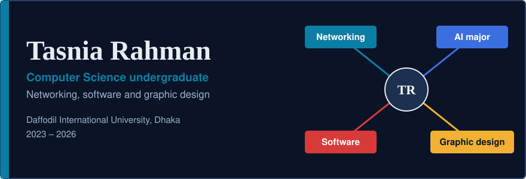
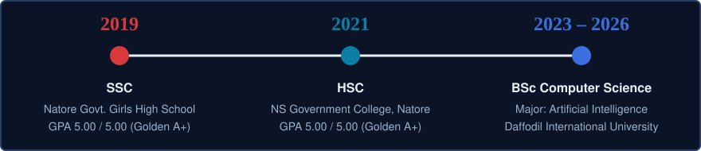
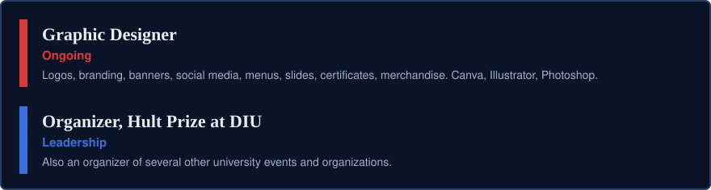
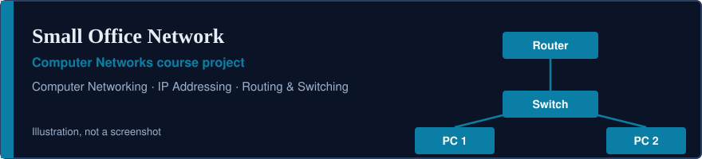
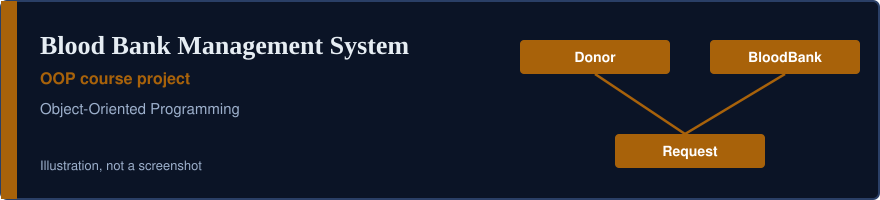
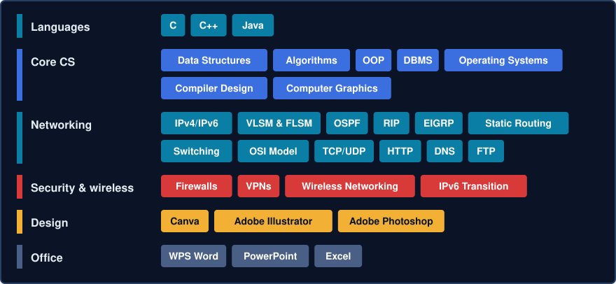
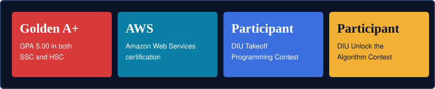
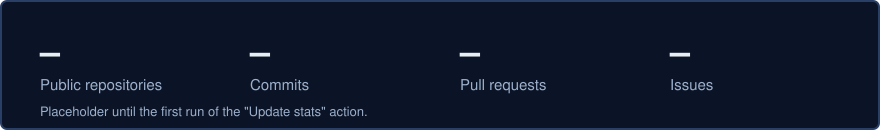

<a href="mailto:tasniarahman0501@gmail.com">tasniarahman0501@gmail.com</a> ·
<a href="mailto:rahman2305101794@diu.edu.bd">rahman2305101794@diu.edu.bd</a>

Computer Science undergraduate at Daffodil International University, majoring in Artificial Intelligence. Strongest in computer networking (IP addressing, subnetting, routing, switching, network security) and AWS-certified. Also a graphic designer and an event organizer. Has completed the project for every course taken.

Designed and implemented a small office network, applying IP addressing, subnetting, routing and switching.

A database-driven system for storing and managing donor and blood information.

A blood bank management application built with Object-Oriented Programming principles.

Also completed projects for every coding course: C, C++, Java, Data Structures, Algorithms, Operating Systems, Compiler Design and Computer Graphics.

Gmail: tasniarahman0501@gmail.com 
University: rahman2305101794@diu.edu.bd 
Languages: Bangla, English, Hindi

